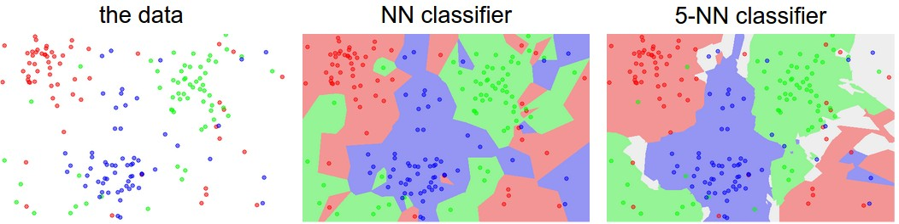

# k-Nearest Neighbors (kNN)

This folder contains implementations and experiments using the **k-Nearest Neighbors (kNN)** algorithm for different datasets.

---

## What is kNN?
The k-Nearest Neighbors algorithm is a **supervised learning method** used for both **classification** and **regression** tasks.  
It works by:
1. Storing the entire training dataset.  
2. Calculating distances between a query point and all training points.  
3. Selecting the **k closest neighbors**.  
4. Making predictions based on the majority class for classification.      

---

## Advantages
- **Simple nd intuitive** → easy to understand and implement.  
- **No training phase** → works instantly once data is available.  
- **Flexible** → can be used for classification and regression.  
- **Non-parametric** → no assumptions about data distribution.  

## Disadvantages
- **Computationally expensive at prediction time** → distance must be computed to all training points.  
- **Sensitive to irrelevant features and scaling** → feature normalization often required.  
- **High memory usage** → stores all training data.  
- **Poor performance on very large datasets** → naive approach is O(n) per query.  

## Efficiency / Complexity
- **Training time:**  
  - O(1) if using brute-force (just storing data)  
  - O(n log n) if using KD-Tree or Ball-Tree (tree construction)
- **Prediction time per query:**  
  - O(n * d) for brute-force  
  - O(log n * d) for KD-Tree or Ball-Tree in low dimensions (d < ~20)  
  - High-dimensional data can degrade tree-based performance toward O(n * d)
- **Optimizations / scikit-learn parameters:**  
  - `algorithm` parameter in `KNeighborsClassifier` or `KNeighborsRegressor`:  
    - `'auto'` → automatically selects the best algorithm based on data  
    - `'brute'` → brute-force distance computation  
    - `'kd_tree'` → KD-Tree (efficient for low-dimensional data)  
    - `'ball_tree'` → Ball-Tree (also efficient for low-dimensional data)  
  - Other relevant parameters:  
    - `n_neighbors` → number of nearest neighbors (k)  
    - `metric` → distance metric (default `'minkowski'`)  
    - `leaf_size` → affects tree construction and query speed
