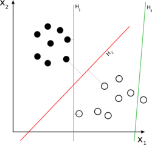

# Linear Classification

This folder contains implementations and experiments using **Linear Classification** methods — models that separate data using a linear decision boundary.

---

## What is Linear Classification?
Linear classification aims to separate data points of different classes using a **hyperplane** defined by a linear equation:

**z = wᵀx + b**

The model predicts class membership based on whether `z` is above or below a threshold (usually 0).  
In binary classification, this defines two half-spaces divided by the decision boundary.  

Popular algorithms using this approach include:
- **Logistic Regression** → probabilistic linear classifier using the sigmoid function  
- **Linear Support Vector Machines (SVMs)** → maximize the margin between classes  
- **Perceptron** → basic linear model updated via misclassification error  

---

## Advantages
- **Simple and efficient** → fast to train and interpret  
- **Scales well** to large datasets with many features  
- **Interpretable coefficients** → the sign and magnitude of weights indicate feature influence  
- **Works well as a baseline model** before using more complex approaches  

---

## Disadvantages
- **Limited to linear decision boundaries** → cannot model complex, nonlinear relationships  
- **Sensitive to feature scaling** → normalization or standardization is usually required  
- **May underperform** on highly nonlinear datasets  

---

## Efficiency / Complexity
- **Training:** typically O(n·d) per iteration (n = samples, d = features)  
- **Prediction:** O(d) per sample  

---

## Typical Use Cases
- Binary classification tasks (e.g., spam detection, sentiment analysis)  
- High-dimensional but linearly separable data (e.g., text classification)  
- As a **baseline model** for comparison with more complex classifiers