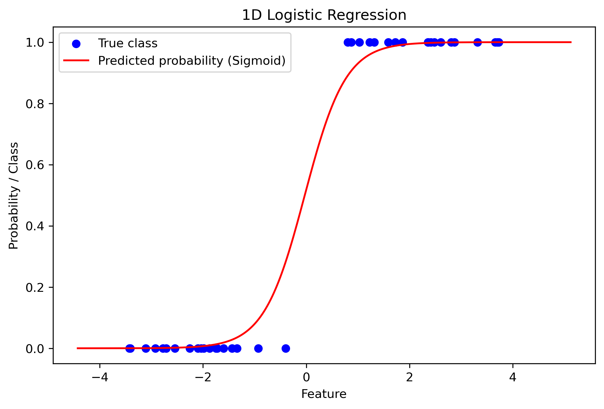

# Logistic Regression

This folder contains implementations and experiments using **Logistic Regression**,  
a fundamental algorithm for **binary classification** that applies a linear model combined with a **sigmoid function** to output probabilities.

---

## What is Logistic Regression?

While **Linear Regression** predicts continuous values, **Logistic Regression** is used for **classification tasks**, where the goal is to predict **discrete class labels** (e.g., 0 or 1).  
If we applied linear regression directly to classification data, the predictions could take **any real value**, including numbers **less than 0 or greater than 1**, which are **not valid probabilities**.

To address this, Logistic Regression introduces the **sigmoid (logistic) function**:

**σ(z) = 1 / (1 + e^(-z))**

where

**z = wᵀx + b**

This transformation maps any real-valued input *z* into the range **(0, 1)** — allowing the model to output a **probability** that a sample belongs to the positive class.

---

## Decision Rule

After computing the probability **p = σ(z)**, the model classifies data points as:

- **ŷ = 1**, if **p ≥ 0.5**  
- **ŷ = 0**, otherwise  

This threshold (usually 0.5) can be adjusted depending on the problem (e.g., for imbalanced datasets).

---

## Loss Function

Instead of minimizing squared errors like in linear regression, Logistic Regression minimizes the **log-loss** (also called **binary cross-entropy**):

**L = -(1/n) × Σ [ yᵢ · log(ŷᵢ) + (1 - yᵢ) · log(1 - ŷᵢ) ]**

This function penalizes confident but incorrect predictions more heavily and provides a smooth gradient for optimization (e.g., via gradient descent).

---

## Advantages
- **Probabilistic output** → provides confidence scores, not just hard class labels  
- **Simple and efficient** → fast to train and interpret  
- **Interpretable coefficients** → each weight reflects feature influence on the log-odds  
- **Works well on linearly separable data**  

---

## Disadvantages
- **Limited to linear decision boundaries** → struggles with nonlinear relationships  
- **Sensitive to outliers and feature scaling**  
- **May underperform** when classes are not linearly separable  

---

## Efficiency / Complexity
- **Training:** O(n·d) per iteration (using gradient descent or similar methods)  
- **Prediction:** O(d) per sample  

---

## Typical Use Cases
- Binary classification (e.g., spam detection, disease diagnosis, customer churn prediction)  
- Baseline model for more complex classifiers  
- Situations requiring **probability estimates** rather than just class labels