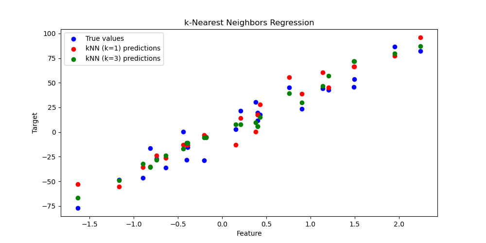

# k-Nearest Neighbors (kNN) – Regression

This folder contains implementations and experiments using the **k-Nearest Neighbors (kNN)** algorithm  for **regression tasks** on different datasets.

---

## What is kNN Regression?
The k-Nearest Neighbors algorithm predicts a **continuous value** for a query point by  
taking the **average (or weighted average)** of the target values of its *k* nearest neighbors.

### How it works:
1. Store the entire training dataset.  
2. Compute distances between the query point and all training samples.  
3. Select the **k closest neighbors**.  
4. Predict the **mean (or weighted mean)** of their target values.  

---

## Advantages
- **Simple and intuitive** → no complex training procedure.  
- **Non-parametric** → flexible, no assumption of linearity.  
- **Can model non-linear relationships** directly from data.  

---

## Disadvantages
- **Computationally expensive at prediction time** → distance to all training points must be computed.  
- **Sensitive to irrelevant features and scaling** → normalization recommended.  
- **Not suitable for very large datasets** → prediction time grows with dataset size.  
- **Prediction can be noisy** if data is sparse or has high variance.  

---

## Efficiency / Complexity
- **Training time:**  
  - O(1) for brute-force (just store data)  
  - O(n log n) for KD-Tree / Ball-Tree construction  
- **Prediction time per query:**  
  - O(n·d) for brute-force  
  - O(log n·d) for KD-Tree / Ball-Tree in low dimensions (d < ~20)  
- **Relevant scikit-learn parameters (`KNeighborsRegressor`)**:  
  - `n_neighbors` → number of neighbors (k)  
  - `weights` → `'uniform'` or `'distance'`  
  - `metric` → distance metric (default `'minkowski'`)  
  - `algorithm` → `'auto'`, `'brute'`, `'kd_tree'`, `'ball_tree'`  