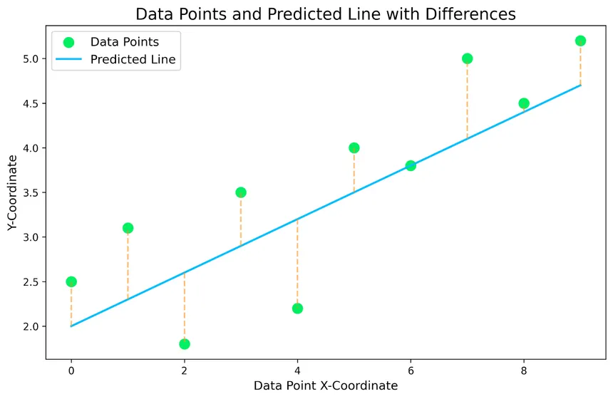

# Ordinary Least Squares (OLS) – Least Squares Method

This folder contains implementations and experiments using **Ordinary Least Squares (OLS)**,  
the standard approach for fitting a **Linear Regression model**.

---

## What is OLS?
The **Least Squares method** minimizes the **sum of squared errors (residuals)** between the predicted values and the actual target values:

**minimize Σ (yᵢ - ŷᵢ)²**

where  
- `yᵢ` = actual target value  
- `ŷᵢ` = predicted value from the linear model  

This results in the best-fitting line (or hyperplane in higher dimensions).

---

## Advantages
- **Closed-form solution** → no need for iterative optimization (when dataset is not too large).  
- **Fast and efficient** for small to medium datasets.  
- **Interpretable coefficients** → shows feature impact directly.  

---

## Disadvantages
- **Sensitive to outliers** → large errors are heavily penalized.  
- **Assumes linearity** between input features and target.  
- **Not suitable for very high-dimensional datasets** without regularization.  

---

## Efficiency / Complexity
- **Closed-form training (matrix inversion):** O(n·d² + d³)  
- **Iterative solvers (e.g., gradient descent):** O(n·d) per iteration  
- **Prediction:** O(d) per sample

