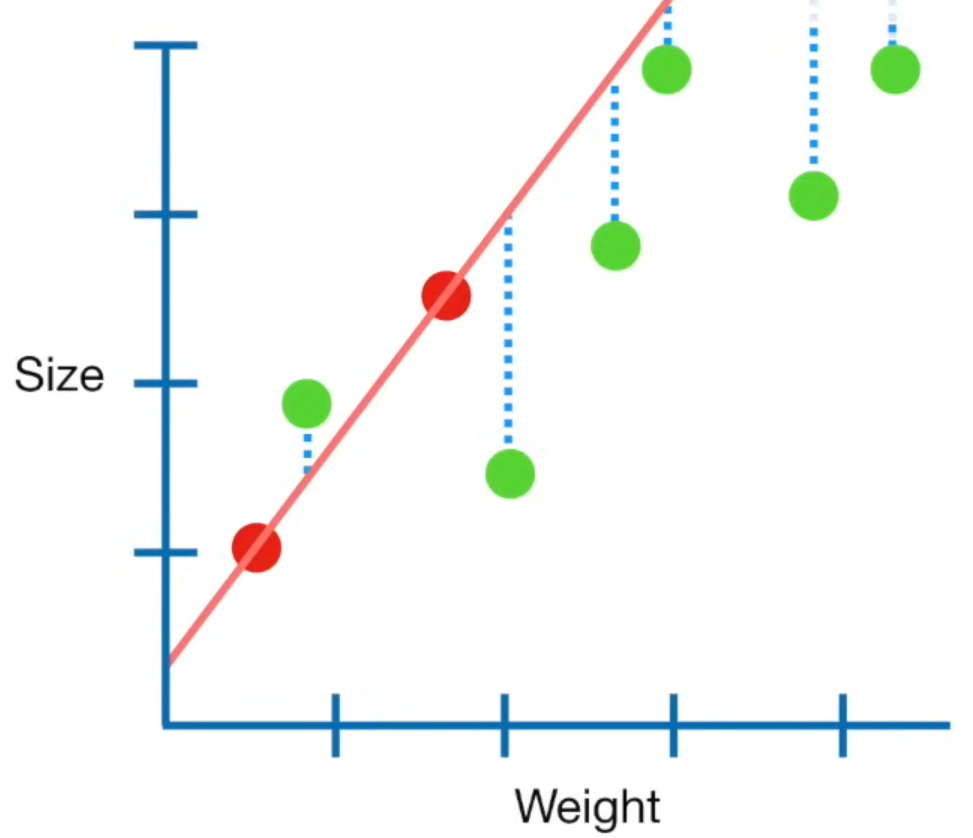
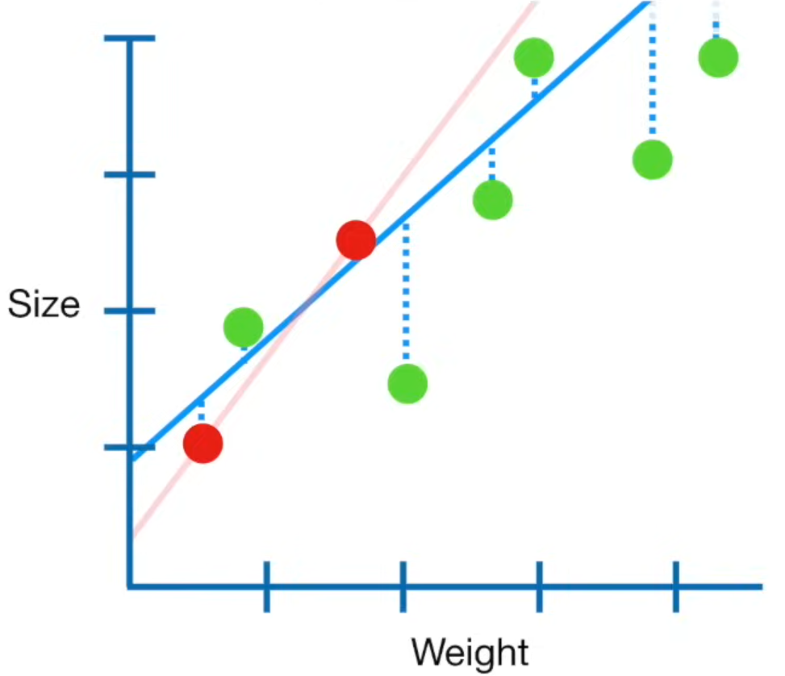

# Ridge Regression

This folder contains implementations and experiments using **Ridge Regression**,  
a regularized variant of **Linear Regression** that helps prevent overfitting.

---

## What is Ridge Regression?
Ridge Regression adds an **L2 regularization term** to the Ordinary Least Squares (OLS) loss function:

**minimize Σ (yᵢ - ŷᵢ)² + α Σ wⱼ²**

where:  
- `yᵢ` = actual target value  
- `ŷᵢ` = predicted value from the linear model  
- `wⱼ` = model coefficients  
- `α` = regularization strength (larger values shrink coefficients more)

The regularization term penalizes large coefficients, reducing the model's sensitivity to individual features and helping to prevent **overfitting**, especially in high-dimensional datasets or when features are correlated.

---

## Advantages
- **Reduces overfitting** → keeps coefficients small, leading to more stable predictions  
- **Handles multicollinearity** → correlated features are less likely to dominate  
- **Closed-form solution available** → similar efficiency to OLS  

---

## Disadvantages
- **Introduces bias** → the model may underfit if α is too large  
- **Requires tuning of α** → choosing the right regularization strength is crucial  
- **Less interpretable** → coefficients are biased, making direct interpretation harder  

---

## Efficiency / Complexity
- **Training time (closed-form solution):** O(n·d² + d³)  
- **Training time (iterative solvers, e.g., gradient descent):** O(n·d) per iteration  
- **Prediction:** O(d) per sample